  <a href="https://www.linkedin.com/in/muhammad-tayyab-se-dev/">LinkedIn</a>
  &nbsp; · &nbsp;
  <a href="https://github.com/M-Tayyab-dev">GitHub</a>

## About

I’m Muhammad Tayyab, a WordPress developer and full-stack developer who enjoys turning ideas into practical, polished web experiences. My work spans website builds, CMS-based solutions, front-end implementation, and quality-focused testing. I also bring a creative-technology mindset to how interfaces are designed and delivered.

Currently, I work as a **WordPress Developer at Ecomalign Digital Agency** and previously completed a **Full-Stack Developer internship at DevelopersHub Corporation**.

## Certifications & Learning

Based on the supplied LinkedIn certifications screenshot:

- Full-Stack Development — DevelopersHub Corporation
- LinkedIn Advertising Fundamentals Certification — LinkedIn
- Building a Social Listening Program with Christina Garnett — Semrush
- SEO Fundamentals Course with Greg Gifford — Semrush
- Mobile SEO Course with Greg Gifford — Semrush
- Mastering Digital PR with Brian Dean — Semrush
- Responsive Web Design — freeCodeCamp

## Skills

**WordPress & CMS**
- WordPress development
- Site building
- WordPress website implementation
- Plugin Development 

**Web Development**
- Web development
- Full-stack development

**Marketing & Search**
- Search engine optimization (SEO)
- LinkedIn advertising

**Quality & Delivery**
- Quality assurance mindset
- Website review and troubleshooting

> Skills above are limited to the supplied profile screenshots and experience details. Add specific programming languages, frameworks, testing tools, or platforms only when you can verify them from your project history or resume.

## Education & Recognition

Education details and academic awards are not listed here yet because the supplied screenshots do not verify the degree, CGPA, or named competition results. I’m proud to have ranked at the top in my class’s web project expo and received a trophy; this is presented as a personal academic highlight, not as a national award.

## Connect

- [GitHub](https://github.com/M-Tayyab-dev)
- [LinkedIn](https://www.linkedin.com/in/muhammad-tayyab-se-dev/)

  

